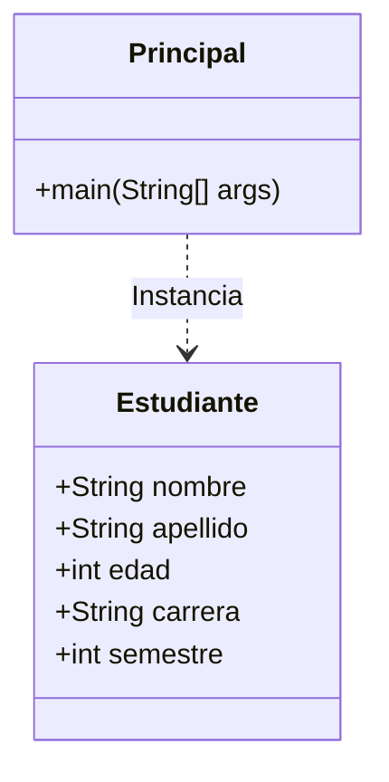

# Actividad-Asincronica.-Mi-primera-clase-y-objeto-en-Java-G5
Introducción a la Programación Orientada a Objetos (POO).
# Sistema de Registro Académico - Introducción a la POO

Este repositorio contiene la solución práctica para el componente inicial del sistema académico de la **Universidad Técnica de Ambato**. El objetivo principal es aplicar los conceptos fundamentales de la **Programación Orientada a Objetos (POO)** en el lenguaje Java, estructurando la información mediante clases y objetos, y gestionando el desarrollo de forma colaborativa a través de GitHub.

---

## 👥 Integrantes del Grupo
*   **Alulema Chato Sandra Jasmin**   (README / GITHUB ) - *[SandraAlulemalk]*
*   **Ortiz Mosquera Valeria Valentina** (Informe de Grupo / Código en Java) - *[valentinaortiz16]*
*   **Guaman Sagñay Joselyn Maribel** ( Objetivos / Conclusión) - *[joselyng07]*
*   **Armas Jaya Anthony Daniel** (Desarrollador / QA Tester) - *[Anthony-GTX]**
*   **Integrant** (EVIDENCIA DE GITHUB / OBJETIVOS) - *[Andyyyxx27]*


---

## 🎯 Objetivo de Aprendizaje
Comprender y aplicar los conceptos fundamentales de la programación orientada a objetos mediante el diseño e implementación de una clase en Java, identificando sus atributos, creando objetos y evidenciando el trabajo colaborativo en GitHub.

---

## 🛠️ Estructura del Proyecto y Diagrama de Clases

El proyecto consta de dos clases principales ubicadas en el paquete por defecto o estructurado:
1.  `Estudiante`: Molde que define los atributos de los alumnos.
2.  `Principal`: Clase que contiene el método `main` para ejecutar la simulación e instanciar los objetos.

### Diagrama de la Clase Estudiante (Mermaid)



### Descripción de Atributos
*   `nombre` (String): Almacena el primer y segundo nombre del estudiante (Ej: `"Luis Alberto"`).
*   `apellido` (String): Almacena los apellidos del estudiante (Ej: `"Pérez López"`).
*   `edad` (int): Edad cronológica en años (Ej: `20`).
*   `carrera` (String): Programa académico al que pertenece (Ej: `"Ingeniería en Software"`).
*   `semestre` (int): Nivel o ciclo académico actual (Ej: `3`).

---

## 🚀 Instrucciones de Ejecución

### Requisitos Previos
*   Tener instalado el **Java Development Kit (JDK)** (versión 11 o superior recomendada).
*   Un entorno de desarrollo como **Visual Studio Code** (con la extensión *Extension Pack for Java*) o **Apache NetBeans**.

### Pasos para Ejecutar
1.  **Clonar el repositorio:**
    ```bash
    git clone https://github.com
    ```
2.  **Abrir el proyecto** en su IDE de preferencia.
3.  **Compilar y Ejecutar:**
    *   Si usa **VS Code**: Abra el archivo `Principal.java` y presione el botón `Run` que aparece sobre el método `main`.
    *   Si usa **NetBeans**: Haga clic derecho sobre el proyecto o sobre `Principal.java` y seleccione `Run File` (Shift + F6).
    *   **Línea de comandos:**
        ```bash
        javac Estudiante.java Principal.java
        java Principal
        ```

---

## 💻 Evidencias de Funcionamiento

Cuando el programa se ejecuta correctamente, la salida en la consola de comandos de Java debe verse de la siguiente manera:

```text
==================================================
        UNIVERSIDAD TÉCNICA DE AMBATO
  SISTEMA ACADÉMICO - REGISTRO DE ESTUDIANTES
==================================================

Estudiante 1:
--------------------------------------------------
Nombre Completo: Carlos Andrés Mendoza Castro
Edad: 20 años
Carrera: Ingeniería en Software
Semestre: Tercer Semestre (3)

Estudiante 2:
--------------------------------------------------
Nombre Completo: María Fernanda Ortiz Reyes
Edad: 21 años
Carrera: Ingeniería en Software
Semestre: Cuarto Semestre (4)

Estudiante 3:
--------------------------------------------------
Nombre Completo: Juan José Jiménez Peralta
Edad: 19 años
Carrera: Ciberseguridad
Semestre: Segundo Semestre (2)

==================================================
Proceso de simulación finalizado con éxito.
```

---

## 📦 Historial de Contribuciones (Commits Relevantes)
Para garantizar la validez de la evaluación en Moodle y cumplir con los criterios de co-evaluación, se registran los siguientes hitos de desarrollo colaborativo:
*   `feat: Crear estructura base e implementar clase Estudiante con atributos` (Por: Integrante 1)
*   `feat: Implementar clase Principal, instanciar objetos y salidas de pantalla` (Por: Integrante 2)
*   `docs: Diseñar diagrama de clases y redactar documentación del archivo README.md` (Por: Integrante 3)
